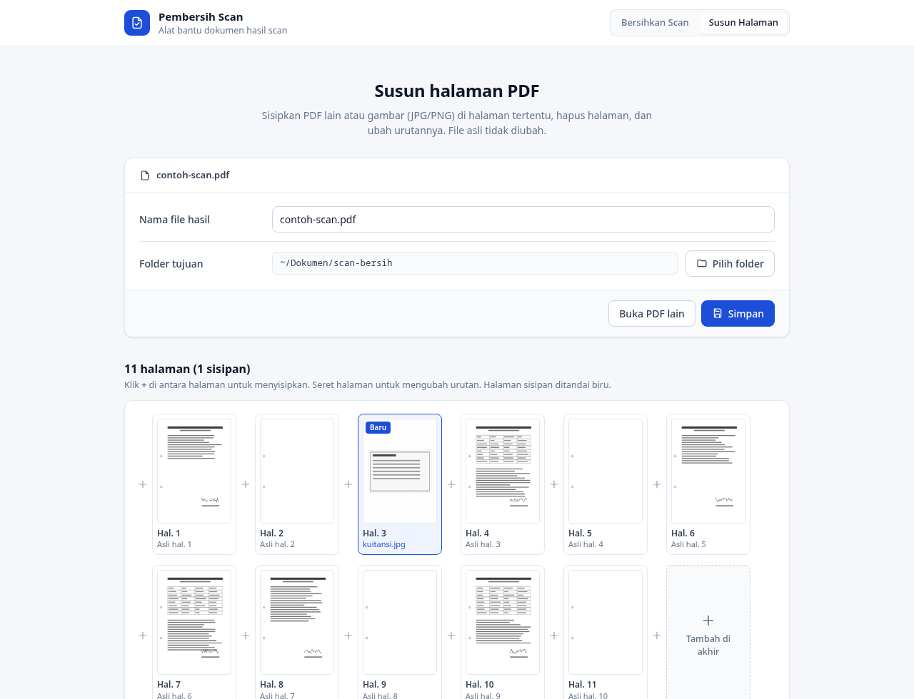

# Pembersih Scan

Aplikasi web lokal untuk membersihkan PDF hasil **scan bolak-balik (duplex)**: halaman belakang yang kosong, yang isinya hanya bayangan lubang perforasi, dibuang otomatis. Sisi belakang yang berisi data atau tanda tangan tetap disimpan.

Ada juga alat **Susun Halaman** untuk menyisipkan PDF lain atau gambar (JPG/PNG) di halaman tertentu, menghapus halaman, dan mengubah urutan.

Semuanya berjalan di komputer sendiri. Tidak ada file yang dikirim ke internet, dan file asli tidak pernah diubah.


## Fitur

**Bersihkan Scan**
- Deteksi otomatis halaman kosong. Pinggir halaman tempat bayangan lubang perforasi diabaikan.
- Pratinjau thumbnail per halaman. Klik untuk mengubah status simpan/buang, dan lihat halaman dalam ukuran besar.
- Masukkan banyak file sekaligus, atau satu folder penuh. Setiap file tetap diproses sendiri-sendiri.
- Simpan dengan **nama file yang sama** ke folder pilihan, dengan folder tujuan yang bisa diatur per file.
- Pengaman: ada konfirmasi sebelum menimpa file, dan penyimpanan ke folder asal ditolak.
- Batas deteksi bisa diatur, dan ada mode cepat (langsung simpan tanpa pemeriksaan).

**Susun Halaman**
- Sisipkan PDF lain (semua halaman atau sebagian, misalnya `1-3, 5`) atau gambar di posisi mana pun.
- Ukuran halaman gambar mengikuti PDF dasar, dan foto dari HP yang miring diluruskan otomatis.
- Hapus halaman dan ubah urutan dengan cara diseret.



## Kebutuhan

- Linux dengan Python 3.9+
- [Pillow](https://python-pillow.org/)
- [Poppler](https://poppler.freedesktop.org/) (`pdftoppm`, `pdfseparate`, `pdfunite`, `pdfinfo`)
- `curl`

```bash
# Arch / Manjaro
sudo pacman -S python python-pillow poppler curl
# Debian / Ubuntu
sudo apt install python3 python3-pil poppler-utils curl
# Fedora
sudo dnf install python3 python3-pillow poppler-utils curl
```

## Instalasi

```bash
git clone https://github.com/aljuan14/duplex-scan-cleaner.git
cd duplex-scan-cleaner
./install.sh
```

Skrip ini memasang perintah `bersihkan-scan` di `~/.local/bin` dan ikon **Pembersih Scan** di menu aplikasi.

## Cara pakai

```bash
bersihkan-scan          # jalankan di latar belakang dan buka browser
bersihkan-scan stop     # matikan
```

Aplikasi juga bisa dibuka dari menu aplikasi, atau dimatikan lewat tombol **Matikan** di halaman. Alamatnya `http://127.0.0.1:8765` dan hanya bisa diakses dari komputer ini.

1. Pilih **folder tujuan**.
2. Seret PDF atau folder ke halaman, atau klik **Proses satu folder**.
3. Periksa thumbnail: hijau berarti disimpan, merah berarti dibuang. Klik thumbnail untuk mengubahnya.
4. Klik **Simpan** atau **Simpan semua**.

Tanpa instalasi, aplikasi bisa dijalankan langsung dengan `python3 server.py`.

## Cara kerja deteksi

Setiap halaman dirender kecil (50 dpi, grayscale). Lalu dihitung persentase piksel gelap di area tengah halaman: 12% pinggir kiri/kanan dan 3% atas/bawah diabaikan supaya bayangan lubang tidak ikut terhitung. Halaman dengan tinta di bawah batas (default 0,1%) dianggap kosong.

Pada hasil scan Epson yang diuji, halaman kosong bernilai tepat 0%, sedangkan halaman berisi paling sedikit sekitar 2,8%. Jaraknya jauh, jadi deteksinya andal. Untuk scanner lain, batasnya bisa diatur lewat slider.

Halaman dipilih dan digabung dengan `pdfseparate`/`pdfunite` tanpa dikompres ulang, jadi kualitas scan tidak berubah.

## Struktur

| File | Isi |
|---|---|
| `server.py` | Server HTTP lokal (hanya library bawaan Python + Pillow) |
| `index.html` | Halaman Bersihkan Scan |
| `susun.html` | Halaman Susun Halaman |
| `style.css` | Tampilan bersama |
| `bersihkan-scan` | Peluncur: menjalankan, membuka, dan mematikan server, serta menyalakan ulang otomatis kalau aplikasi diperbarui |
| `install.sh` | Pemasang perintah dan ikon menu |

## Lisensi

[MIT](LICENSE)
